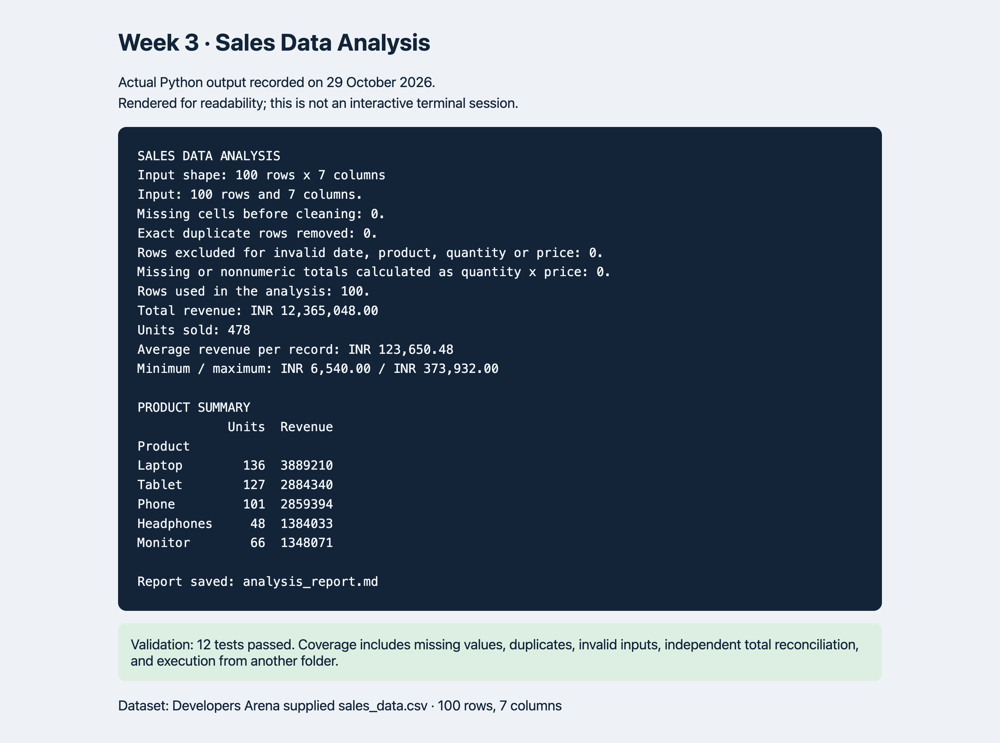

# Week 3: Sales Data Analysis

This beginner Python project uses pandas to explore the Developers Arena sales dataset, check its quality, calculate sales metrics, and write a Markdown report.

## Setup and run

Use Python 3.10 or later. Download the repository ZIP, extract it, and open a terminal in the extracted folder.

macOS / Linux:

```sh
python3 -m venv .venv
source .venv/bin/activate
python -m pip install -r requirements.txt
python sales_analysis.py
python -m unittest -v
```

Windows Command Prompt:

```bat
py -3 -m venv .venv
.venv\Scripts\activate.bat
python -m pip install -r requirements.txt
python sales_analysis.py
python -m unittest -v
```

The program reads its bundled CSV relative to the Python file, so it also works when launched from another directory. It regenerates `analysis_report.md`. Optional custom files:

```sh
python sales_analysis.py --input other_sales.csv --report other_report.md
```

A custom CSV must include Date, Product, Quantity, Price and Total_Sales. Dates use YYYY-MM-DD. Quantity must be a positive whole number and Price must be nonnegative. The report destination's directory must already exist. Missing files, invalid columns, unusable records and conflicting totals produce a readable error.

Tested on macOS with Python 3.12.14 and pandas 2.2.3. Windows and Linux commands are provided but were not executed on those systems.

## Files

- `sales_analysis.py`: loading, cleaning, analysis and report generation.
- `sales_data.csv`: unchanged practice dataset supplied by the Week 3 portal.
- `analysis_report.md`: generated results, cleaning counts, exploration and findings.
- `requirements.txt`: pandas version used.
- `test_analysis.py`: runnable tests using Python's built-in unittest.
- `test_results.txt`: actual test execution log.
- `sample_output.txt`: actual program output.
- `screenshot.png`: screenshot of recorded program output and test summary.

## Follow the five task steps

1. **Setup and load:** install pandas and use `pd.read_csv()` to create a DataFrame. A DataFrame is a table with named columns.
2. **Explore:** inspect `head()` for sample rows, `shape` for dimensions, `dtypes` for types and `isna().sum()` for missing values. The downloaded CSV has 100 rows and **7 columns**, although the portal's preview label says 5 columns.
3. **Clean:** remove exact duplicate rows under the documented practice-data assumption. Convert dates and numbers, trim product names and exclude records missing essential values. Calculate a missing total from valid quantity and price. Stop if an existing total conflicts with quantity times price.
4. **Analyze:** use `sum()`, `mean()`, `min()` and `max()` for metrics. `groupby('Product')` collects records for the same product before adding their units and revenue.
5. **Report:** write a formatted Markdown report with calculated results, product rankings, cleaning counts and limitations. Run the tests before submission.

## Functions and technical requirements

`clean_data()` returns a cleaned copy and notes, preserving the original CSV. `summarize()` returns metrics and a product summary. `build_report()` turns those results into Markdown. `main()` handles command-line paths, reads the CSV and saves the report. Comments explain each main step.

The project uses pandas to load and analyze the data, handles missing values explicitly, calculates six headline metrics and compares products by units and revenue. Documentation and test evidence are included.

## Findings

The supplied 100 records total **INR 12,365,048.00** and **478 units**. **Laptop** leads both units sold (136) and revenue (INR 3,889,210.00). Mean revenue per sales record is INR 123,650.48.

The supplied file contains no missing cells or exact duplicates, and all totals match quantity times price. The tests use separate small examples to verify cleaning behavior; those examples are not mixed into the supplied data.

Source: Developers Arena Week 3 Download CSV, downloaded 29 October 2026 from the internship task page. INR follows the portal's sample code, since the CSV has no explicit currency field. These are practice-data findings, not profit estimates or forecasts. Customer IDs are supplied example identifiers; no personal contact information is included.

## Testing and execution evidence

Run `python -m unittest -v` for 12 tests covering known metrics, missing values, duplicates, invalid values, conflicting totals, missing columns, empty data, zero-price sales and ties. The supplied data is independently reconciled using Python's csv module and integer arithmetic. A subprocess test checks execution from a different working directory and a missing-file error.



The screenshot shows actual saved Python output rendered for readability, not an interactive terminal session. The full text is in `sample_output.txt` and `test_results.txt`.

## Quick practice

Read the report, then explain why units sold and revenue can rank products differently. In a separate copy of the CSV, blank one Total_Sales cell and rerun with `--input`: the program should calculate that amount from Quantity and Price. Do not edit the original supplied dataset.
